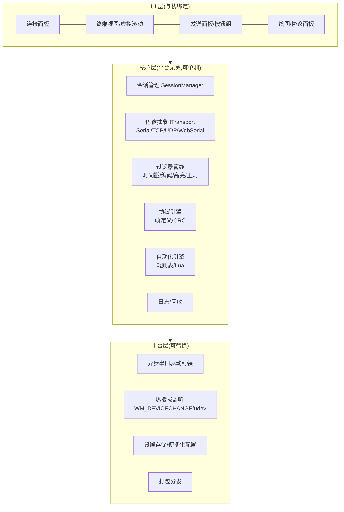

# 串口调试工具 · 项目规划书

> 版本 v1.0(2026-11-01) · 依据《01-开源串口工具调研与功能对比报告》制定
> 状态:立项规划阶段 · 技术栈**待定**(由 M0 技术验证定案,见 §5)

---

## 1. 项目定位

### 1.1 一句话定位

> 面向嵌入式开发者的**现代化开源串口调试工作台**:把"终端收发、实时示波器、协议帧解码"合为一体,以高吞吐稳定性和无门槛自动化为核心卖点。

### 1.2 背景与动机(来自调研)

- 中文社区五大痛点未被同时解决:高波特率丢数据、UI 老旧、平台锁定、无脚本自动化、编码乱码(报告 §5.3)。
- 头部开源 Pro 化(Serial Studio 4.x)、闭源标杆停更(SSCOM/串口猎人)、终端套件串口浅(Tabby/WindTerm)、收发与示波器割裂(VOFA+/SerialPlot)(报告 §0/§4)。
- "终端 + 示波器 + 协议解码"三合一、CRC 面板、多串口统一时间戳、内建虚拟串口、RTT 通道、AI/MCP 接入均为开源空白(报告 §3.3/§6.6)。

### 1.3 目标用户画像

| 画像 | 典型场景 | 核心诉求 |
|---|---|---|
| 嵌入式固件工程师(主) | printf 日志、DMA 数据回传、外设联调 | 高吞吐不丢数据、时间戳、日志落盘、HEX |
| 模组/物联网调试者 | ESP32/4G DTU 的 AT 指令、MQTT/TCP 透传 | AT 模板、自动应答、发送序列、多传输层 |
| 学生/竞赛选手(智能车/电赛) | IMU/电机调参、波形观察 | 内置示波器、JustFloat/FireWater 兼容 |
| 工控/测试工程师 | Modbus 485、自定义协议帧 | CRC 自动计算、帧解析、自动化回归 |

### 1.4 非目标(明确不做)

- ❌ 不做 SSH/Telnet 全功能终端(与 Tabby/WindTerm 正面竞争无意义,串口是主业)。
- ❌ MVP 不做总线协议栈级工具(CAN/SPI 主机模拟,后续以插件形态评估)。
- ❌ 不做闭源 Pro 分层:承诺**开源版全功能免费**(这是对 Serial Studio Pro 化的正面差异化,也是社区信任基础)。
- ❌ 不追求移动端(App);Web 版定位为引流入口而非主力。
- ❌ **不承诺 460800 以上波特率**(2026-11-01 范围决策):921600 为 P1 探索评估项(G3b,只测不承诺),3M 及以上不做;UI 保留自定义波特率入口,但支持承诺线画在 460800。

---

## 2. 平台与发行策略

**决策:Windows 优先,架构预留跨平台**(2026-10-31 与项目负责人确认)。

- 首发 Windows 10/11 x64,覆盖 90% 目标用户;安装器 + 便携 zip 双产物,GitHub Releases + winget/scoop 分发(报告 §6.5)。
- 跨平台预留是**架构约束**而非版本承诺:
  - 串口 I/O、编码转换、日志、协议解析等全部下沉到平台无关核心层(§5.3);
  - 禁止在 UI/业务层直接调用平台 API;
  - 每个里程碑的验收标准中包含"平台耦合度检查"(UI 层不得 import 平台专属模块)。
- macOS/Linux 作为 P2 阶段评估项,依社区需求与 CI 成本决定。

---

## 3. 竞争定位与差异化策略

| # | 差异化点 | 对标缺口 | 优先级 |
|---|---|---|---|
| 1 | **高吞吐稳定性红线**:460800 满速持续流零丢包、UI 不卡、断流自动恢复(架构余量实测 ~10Mbps) | SSCOM 口碑核心,但已停更且无现代替代 | P0(架构期落实) |
| 2 | **现代化 UI + 中文优先**:暗色主题、高 DPI、合理信息密度;默认中文,可切英文 | 国产闭源全线老旧;开源工具多英文优先 | P0 |
| 3 | **全功能免费开源**(MIT/Apache-2.0,见 D2) | Serial Studio Pro 化让出的空间 | P0(承诺) |
| 4 | **无门槛自动化**:规则表式自动应答(收匹配→发送/CRC 填充,零脚本)+ Lua 进阶脚本 | 开源侧自动应答均需写脚本;TTL/Lua 门槛高 | P1 |
| 5 | **"终端-示波器-协议解码"三合一**:收发同屏 + JustFloat/FireWater 兼容绘图 + 帧定义解析 | VOFA+ 闭源、SerialPlot 不能发、Serial Studio Pro 化 | P1(绘图)/P2(协议) |
| 6 | **AI/MCP ready**:内建 MCP server,让 AI Agent 能枚举串口/收发/读日志 | 2026 趋势,开源无占位者(报告 §6.6) | P2 |

定位口号(对外传播参考):*"为嵌入式开发者打造的下一代串口工作台"*。

---

## 4. 功能规划

### 4.0 功能优先级原则

- P0 = MVP 红线,发布 0.1.0 前必须全部完成,**严禁范围蔓延**;
- P1 = 竞争力功能,决定"能否替代 SSCOM/XCOM 成为主力工具";
- P2 = 差异化功能,决定"能否形成自己的生态位"。

### 4.1 P0 — MVP(对应里程碑 M1)

**连接与会话**
- [ ] 串口枚举(含 USB 信息友好显示:VID/PID/设备名)、热插拔实时刷新
- [ ] 参数配置:波特率(预设档 110~460800 + 自定义非标;承诺线 460800)、数据位/停止位/校验/流控
- [ ] 断线自动重连(指数退避)并恢复全部参数;DTR/RTS 手动线控(复位板卡的刚需)
- [ ] 连接档案(命名保存/快速切换,含发送面板配置)

**收发**
- [ ] 文本/HEX 双模式收发;HEX 紧凑视图与 hex-dump 视图
- [ ] "发送新行"可配置(CR/LF/CRLF/无,默认 CRLF——AT 场景第一大坑)
- [ ] 发送历史(↑键调回)+ 可编辑快捷发送按钮组(≥16 条,支持每条独立 HEX/换行开关,对标 SSCOM)
- [ ] 编码切换:UTF-8/GBK/ASCII,乱码容错显示(十六进制兜底渲染)

**接收区性能与可读性**
- [ ] 虚拟滚动(百万行级不卡)、滚动锁定、暂停捕获
- [ ] 每条记录可选时间戳(ms 精度,开机/绝对两种基准)
- [ ] 关键词高亮与过滤(包含/排除/正则)

**日志**
- [ ] 自动落盘:纯收/收发、文本/二进制可选,按日期/大小滚动分文件
- [ ] 日志文件即会话记录,可从 UI 直接打开所在目录

**壳与分发**
- [ ] 暗色/亮色主题;中文默认界面
- [ ] 便携 exe(免安装)+ 安装器;winget/scoop 提交
- [ ] 崩溃兜底:异常捕获 + 崩溃日志提示

**明确不做(0.1.0 红线)**:绘图、脚本、协议解析、多串口标签、TCP/UDP、自动应答。

### 4.2 P1 — 竞争力版(M2~M3)

- [ ] **CRC/校验和面板**:CRC-8/16/32 常用目录(Modbus/CCITT/XMODEM/CAN)+ 累加和/异或;发送时自动追加/填充
- [ ] **多标签多串口**:每标签独立会话与过滤;全局统一时间基准(跨口日志对齐)
- [ ] **自动应答规则表**:匹配条件(关键字/正则/HEX 模式)→ 动作(发送/延时/置标记),零脚本可用
- [ ] **定时发送**与发送序列(序列内可插延时)
- [ ] **TCP/UDP 调试**(client/server/UDP,与串口能力同规格;网络-串口透传桥)
- [ ] **实时绘图**:JustFloat/FireWater 协议兼容(直接复用 VOFA+ 生态教程与下位机习惯)、CSV 导出
- [ ] 插件机制 v1(协议解析器即插件,参考 Serial Studio 帧解析器设计)
- [ ] 会话日志回放(拖动时间轴重看)

### 4.3 P2 — 差异化版(M4+)

- [ ] Lua 脚本自动化(内嵌 mlua/sol2,`expect/read/write/send` API 对齐 tio 习惯)
- [ ] 协议帧定义解析器:帧头帧尾 + 字段表(进制/字节序/位域)+ hex-dump 联动高亮;内置 NMEA/Modbus RTU 模板
- [ ] 虚拟串口对(集成/引导安装 com0com,或自研内核方案评估)+ 内建回环自测模式
- [ ] **MCP server**:枚举串口/收发/读日志/注入数据,供 AI Agent 与 IDE 集成
- [ ] Web 版引流(Web Serial API,与桌面共享解析核心)
- [ ] SEGGER RTT 支持(J-Link DLL/libjaylink 评估)、VS Code 扩展
- [ ] macOS/Linux 版本评估与发布

### 4.4 非功能需求(量化验收)

| 指标 | 目标 | 说明 |
|---|---|---|
| 吞吐(P0 验收线) | **460800 bps(≈46KB/s)持续 ≥10 min,零丢字节**,CH340/CP2102/FT232 三芯片全过,UI 帧率 ≥30fps | 架构余量:M0 实测 ~10Mbps(460800 的 ~22 倍)零丢包;专用 I/O 线程+批量缓冲+UI 节流 |
| 波特率承诺线 | P0 = 460800(验收线);921600 = P1 探索评估(G3b,达标可写入文档,不入承诺);≥3M 不做 | 2026-11-01 范围决策;CH340 在 460800 处于舒适区(临界点 921600) |
| 日志 | 1 GB 单文件/百万行级滚动查看不卡顿 | 虚拟滚动 + 分块索引 |
| 内存 | 空闲 <80 MB;3M 满流 <250 MB | 与 Electron 常态(150-250MB)区分,候选栈 POC 实测定标 |
| 启动 | 冷启动 <2 s | 便携版 |
| 可靠性 | USB 误拔不死机,插回 <2 s 自动恢复参数 | SSCOM 口碑核心项 |
| 兼容 | Win10 21H2+/Win11,高 DPI 无模糊;CH340/CP210x/FTDI 全兼容 | CH340 921600 硬件限速在文档说明(报告 §5.3) |

---

## 5. 技术方案

### 5.1 技术栈:✅ 已定 —— Tauri 2 + Rust(2026-11-01,ADR-001)

四档候选经 M0 统一场景 POC 实测后定案,**详见 [decisions/ADR-001](decisions/ADR-001-技术栈.md)**。核心数据:Rust 核心 ~10Mbps 持续流零丢包、延迟 p95 0.23ms、RSS 14MB、单 exe 527KB;WPF 被实测一票否决(System.IO.Ports 持续高流量丢 8.8%);Electron 管线达标但 430MB 内存不合格;PySide6 缓解后达标,列为回退预案。

| 组合 | 构成 | 实测结论 |
|---|---|---|
| **A** ✅ | Tauri 2 + Rust(serialport crate)+ Web 前端 | **全维度最优,选定** |
| B | Qt 6(C++ 或 PySide6)+ QCustomPlot | 缓解后达标,回退预案 |
| C | Electron + TypeScript | 丢包达标,内存/体积不合格 |
| D | C#/WPF + System.IO.Ports | **持续高流量丢数据,一票否决** |

### 5.2 选型流程(M0 已执行完毕)

每个候选栈做一个**同一验收清单**的最小串口终端 POC(预计每栈 1~2 天):

1. 枚举串口(含 VID/PID)→ 打开/关闭/参数设置;
2. 后台线程收 921600 bps 持续流 → 前端列表滚动显示(节流渲染);
3. 发送 HEX/文本;断开重连恢复;保存 100MB 日志文件;
4. 打包便携 exe,记录体积/内存/冷启动实测值。

评分矩阵(各 1-5 分):吞吐实测 / 内存体积 / UI 现代度开发效率 / 跨平台预留成本 / 团队学习曲线 / 绘图表格式组件可得性 / 生态风险(依赖维护度)。**POC 结论写入 `docs/decisions/ADR-001-技术栈.md` 后锁定。**

### 5.3 架构约束(选栈前即生效)



**硬性规则**(无论选哪栈):
1. I/O 线程独立于 UI 线程,收发走环形缓冲 + 批量事件,UI 按固定帧率消费;
2. 所有跨层通信走 `ITransport`/事件总线抽象,禁止 UI 直接触碰串口句柄;
3. 编码/过滤/协议解析为纯函数管线,可脱离 GUI 做单元测试与基准测试;
4. `poc/` 中先建基准工具(回环测试脚本 + 丢包统计),作为一切性能验收的量尺。

### 5.4 关键决策点台账

| ID | 决策 | 状态 | 备注 |
|---|---|---|---|
| D1 | 技术栈 | ✅ **已定(2026-11-01)** | **Tauri 2 + Rust(serialport crate)+ Web 前端**;四栈 POC 实测定案,见 [decisions/ADR-001](decisions/ADR-001-技术栈.md);M1 带 G1/G2/G3 复验门 |
| D2 | 开源协议 | ✅ **已定(2026-11-01):Apache-2.0** | 含专利条款,与"全功能免费开源"承诺一致;与 Serial Studio 的 GPL+Pro 路线划清界线 |
| D3 | 脚本语言 | ⏳ 建议 Lua(mlua),P2 评估 Python | 嵌入式用户对 Lua 接受度高(tio/llcom 先例);与 Rust 栈兼容好 |
| D4 | 项目名/代号 | ✅ **已定(2026-11-01):PortPilot**(暂定) | 串口领域查重干净;GitHub 存在 5+ 个网络端口类跨领域同名小项目,正式建仓时以描述/关键词区分,如需更独特可再议 |
| D5 | 插件机制 | ⏳ P1 设计 | 动态库 vs 脚本插件,参考 ScriptCommunicator/Serial Studio |
| D6 | 仓库与品牌 | ⏳ M1 初 | GitHub 主仓 + Gitee 镜像(国内触达);社区版承诺写入 README |

---

## 6. 里程碑路线图

> 以 1 人全职 + AI 辅助开发、业余投入为准估算,请按实际人力×1.5~2 校正。

| 里程碑 | 目标 | 主要交付物 | 验收标准 | 预估 |
|---|---|---|---|---|
| **M0 立项与选型** | 定案技术栈,搭好工程底座 | POC×N、基准测试工具、ADR-001、CI 骨架、仓库上线(GitHub+Gitee) | §5.2 评分矩阵完成;便携 exe 产出;基准数据落档 | 2~3 周 |
| **M1 MVP 0.1.0** | §4.1 全量 | 可日常使用的稳定版 + 安装器/便携包 | 非功能需求(§4.4)吞吐/日志/重连达标;自用两周不返工 | 4~6 周 |
| **M2 竞争力 0.2** | CRC 面板、多标签、自动应答表、定时/序列、TCP/UDP | 0.2.0 | 替代性测试:日常调试不再打开 SSCOM/XCOM | 4~6 周 |
| **M3 可视化 0.3** | 绘图(JustFloat/FireWater)、CSV 导出、插件机制 v1、回放 | 0.3.0 | 与 VOFA+ 并行跑通同一调参流程 | 4~8 周 |
| **M4 生态 1.0** | Lua 脚本、协议解析器、虚拟串口、MCP server、Web 版引流 | 1.0.0 + 插件文档 + 首批外部贡献者 | 第三方按文档完成一个协议插件;GitHub Star 目标 500+(参考) | 8~12 周 |

节奏约定:每个里程碑收尾必须发布正式版本 + 更新文档;issue/roadmap 公开,吸引早期用户共建。

---

## 7. 风险与对策

| 风险 | 等级 | 对策 |
|---|---|---|
| 高吞吐丢数据(第一技术风险) | 高 | M0 先建基准;I/O 线程+环形缓冲架构红线;用 CH340/CP2102/FT232 三种芯片实测;文档明示硬件限速 |
| 单人/小团队维护中断 | 高 | 严格 MVP 红线防蔓延;插件化分摊;文档与 ADR 制度;社区招维护者 |
| 杀软误报(便携 exe 常见) | 中 | 代码签名证书(预算项);参考 COMTool 的处置说明;优先 winget/scoop 白名单渠道 |
| Electron/Tauri 类栈的性能上限不确定 | 中 | POC 实测定标,不达标即换栈(M0 的意义) |
| 范围蔓延(功能都想做) | 中 | §4.1 排除清单制度化;新功能先 issue 评审再排期 |
| Win11 HVCI 下 com0com 签名问题 | 中 | 内建回环自测模式替代;虚拟串口作为 P2 自研评估 |
| 开源无人问津 | 中 | 上线即发 CSDN/知乎/阿莫/Reddit r/embedded;兼容 VOFA+ 协议借力既有教程生态;Gitee 镜像 |

---

## 8. 工作区目录规划

```
D:\serialport\
├── README.md                     # 工作区导航(已建)
├── docs\
│   ├── 01-开源串口工具调研与功能对比报告.md
│   ├── 02-项目规划.md
│   ├── decisions\                # ADR 技术决策记录(M0 起)
│   │   └── ADR-001-技术栈.md     # POC 结论
│   └── assets\                   # 图表/截图
├── poc\                          # M0:各候选栈最小验证工程(每个独立子目录)
├── bench\                        # 基准测试:回环脚本、丢包统计、报告
├── src\                          # M1 起正式代码
├── tests\                        # 单元/集成测试
└── tools\                        # 辅助脚本(协议生成、发布打包等)
```

---

## 9. 下一步行动清单

**M0(已完成 2026-11-01)**:✅ 环境盘点(发现 Eltima 虚拟对 + CH340)→ ✅ bench 基准(自测/链路基线零丢包)→ ✅ 四栈 POC + 统一场景实测 → ✅ [ADR-001](decisions/ADR-001-技术栈.md) 定案 **Tauri 2 + Rust**。

**M1(进行中)**:
- [x] G1:✅ **通过(2026-11-01)**——MSVC 就位,tauri_app GUI 编译+同探针实测:丢包 -0.06%、延迟 p95 3.43ms、核心进程 RSS 29MB、exe 8.7MB;三个工程坑已沉淀(ADR-001 G1 执行记录)
- [x] G2:✅ **通过(2026-11-01)**——CH340 真机回环(COM9,TXD↔RXD 短接):四波特率全零丢包,460800 达线速 99.1%;921600 零丢包(吞吐 71.8%,驱动成批上送)
- [x] G3:✅ **通过(2026-11-01)**——ESP32-S3 灌流真机验收:460800×30s,5631 块零丢失,满线速;rust-core POC 真机连跑稳定。固件与工程沉淀于 `bench/mcu_firmware/`(回显 + 灌流,PlatformIO 版,`UART_BAUD` 一行切换)
- [ ] 架构任务:I/O 线程免分配环形缓冲 + 线程优先级保护(G1 发现的 emit 堆竞争对策)

> **M1 技术验证门(G1/G2/G3)全部通过(2026-11-01)—— 转入纯开发阶段**:git 建仓 PortPilot(Apache-2.0)✅(GitHub: lje970/PortPilot)、**src 核心层 ✅(2026-11-01:`portpilot-core` v1,ITransport + 无锁 SPSC 环形缓冲 + 自动重连会话,11 单测通过,真机灌流延迟 p95 1.4ms/零背压)**、UI 原型(进行中)、MVP P0 清单开发。
- [ ] 定项目名(D4)、License(D2)、GitHub+Gitee 仓库(D6),`git init` 提交
- [ ] UI 原型:主界面三段式(连接栏 + 终端区 + 发送面板)
- [ ] 把 `rust_core` 的 I/O 线程+mpsc+33ms 节流模式提升为 `src/` 正式核心层(ITransport 抽象)
- [ ] 按 §4.1 P0 清单开发 MVP 0.1.0(bench 作为发版回归门)

## 变更记录

| 版本 | 日期 | 说明 |
|---|---|---|
| v1.0 | 2026-11-01 | 首版:基于三路调研制定;技术栈列为 M0 POC 决策(D1) |
| v1.1 | 2026-11-01 | M0 完成:四栈 POC 实测 + ADR-001 定案 Tauri2+Rust;M1 启动 |
| v1.2 | 2026-11-01 | 范围决策:波特率承诺线调整为 460800(P0 验收线),921600 降为 P1 探索评估(G3b),≥3M 不做;§1.4/§3/§4.1/§4.4/§9 已同步 |
| v1.3 | 2026-11-01 | G1 复验门通过:tauri_app GUI 编译+实测零丢包;新增架构任务(I/O 线程保护) |
